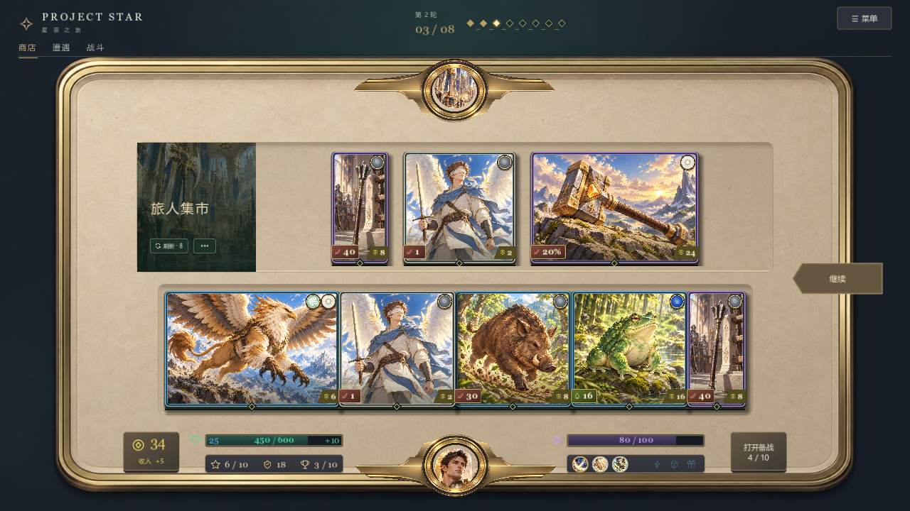
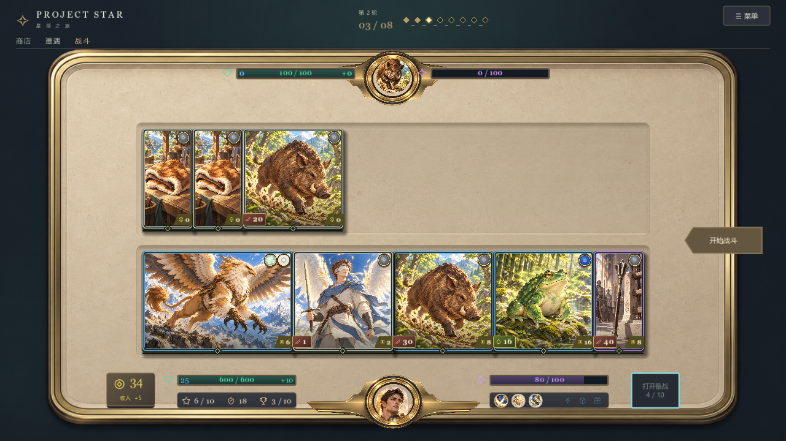

# Godot头像与HUD反馈修复

2026-10-15按用户指出的四处Godot问题修复。底部间距先更新[HTML原型](../design/prototypes/game-16x9.html)，检查后同步原生；头像与导航修复原生迁移错误，原画不变。

## 修复范围

- 头像：圆形着色器只修改透明度，消除纹理重复相乘导致的偏色；上下大头像均按控件局部坐标裁切为72px可见圆，避免覆盖金属框内缘。技能小图标保留原尺寸。
- 导航：分隔线固定在导航下沿，不再受顶栏最小高度影响穿过文字；各阶段选中下划线保留。
- 底部两栏：左右资源、成长与技能入口分别向外移动120px，原244px栏宽和字号保持；360px头像底座两侧分别留出16px间隙。
- 对照夹具：主布局使用与HTML相同的尺寸组合，读取正式Definition数值；边界专项使用独立旧夹具，不再覆盖主布局证据。战斗主布局使用野猪头像。

对应BUG-297～301。整体HTML迁移仍沿用BUG-127跟踪，不能用本次四处修复关闭全部页面验收。

## 验证与证据

构建0警告0错误，全量387/387通过；Godot实际渲染下窗口／缩回／键盘、拖拽、菜单专项均通过。日志位于`output/html-sync-followup-build.log`和`output/html-sync-feedback-*.log`。四档窗口为1280×720、1920×1080、2560×1440、2560×1080；超宽窗口保留16:9有效画布。主布局截图位于`output/ui-html-parity/overview/`，边界专项位于`output/ui-html-parity/native/`；边界专项早于本次四处反馈修复，不作为修复后的外观证据。

本轮浏览器通过本地HTTP打开当前HTML，检查商店、双战场和备战展开；原生由Godot实际渲染截图复查。完整人工对局与宝石专项仍未完成。

