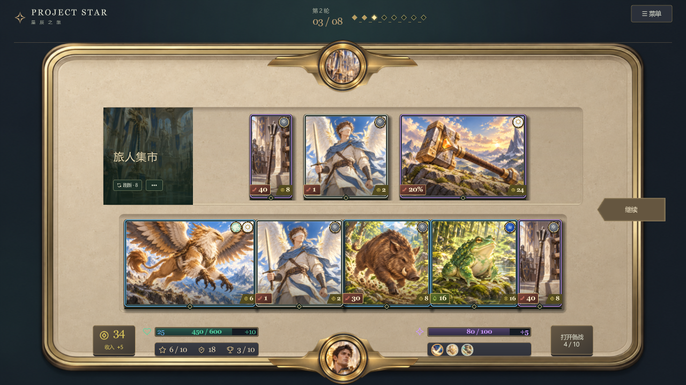
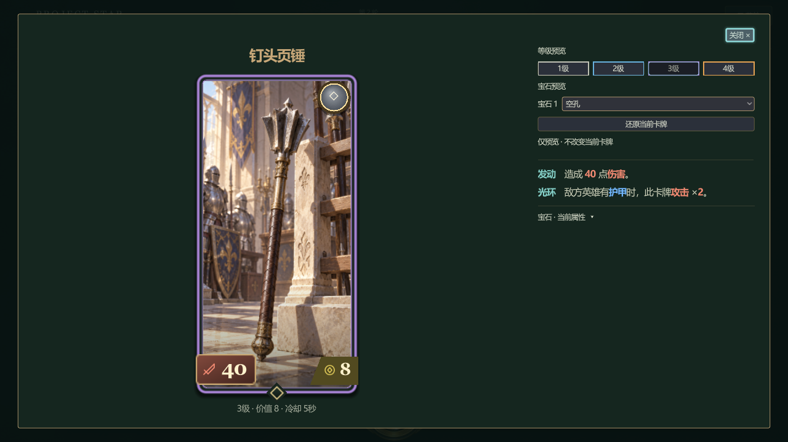
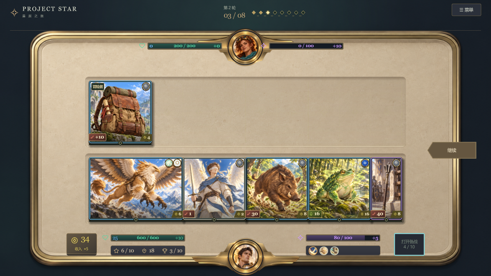

# 统一渲染、分辨率与HUD复查

2026-10-15继续按当前HTML同步Godot，处理用户反馈的图片锯齿、右键文字失真、头像框衔接及HUD信息。对应BUG-302～306；本次不关闭整体视觉迁移BUG-127。

## 已实施

- UI的170份PNG导入启用mipmap，卡牌原画、头像、技能及皮肤共用平滑缩小采样；原始图片文件不变。
- 共享字体使用64px MSDF字形，卡面、右键预览与浮层按实际缩放渲染；取消独立变换取整造成的局部偏移。
- 头像底座保持原比例，按圆孔位置定位，不再按透明画布中心对齐；底部横翼与桌面边框衔接，圆形遮罩按屏幕像素抗锯齿。
- 技能栏移除通用技能、套装和奖励图标，仅显示已获技能；超过6项时显示5项及“展开”，弹出可滚动完整列表。
- 魔法条显示紫色+再生，回放读取冻结值；移除左上三项阶段文字及其选中线。
- PvP遭遇图卡与准备／回放头像绑定实际敌方英雄，候选、战斗复用一次对手请求；怪物插画继续按正式身份展示。

## 验证范围

使用Godot 4.7.2 .NET默认Forward+实际渲染，覆盖设置内全部五档分辨率：1280×720、1600×900、1920×1080、2560×1440、2560×1080。每档生成商店、备战抽屉、三尺寸右键预览、10技能折叠／展开、怪物战场与PvP英雄截图；检查浮层边界、卡牌身份、技能完整数量、英雄头像来源与魔法再生可见值。超宽窗口有效画布为1920×1080，左右留边。

构建0警告0错误，全量387/387通过；原生窗口／缩回／键盘、拖拽、菜单专项通过。构建及全量回归日志为`output/ui-render-quality/build.log`、`verify.log`，原生窗口／缩回、拖拽、菜单日志为同目录`ui-windows.log`、`native-drag.log`、`unified-input.log`。HTML全部15段脚本语法检查通过。截图入口：`res://scripts/Presentation/Playtest/ComponentShowcase.tscn -- --capture-html-parity --centered-overview --render-quality`。

HTML先更新并通过本地HTTP查看，页面切换工具收进“预览工具”，新增PvP英雄样例。浏览器结果不代替原生检查；完整人工对局和宝石专项仍未完成。

